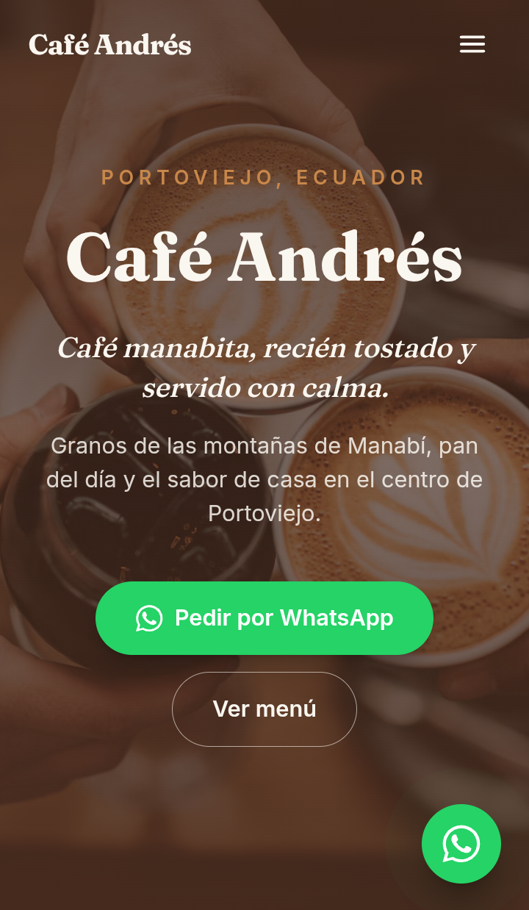

# ☕ Café Andrés — Landing page

Landing page de ejemplo para una cafetería ficticia en **Portoviejo, Ecuador**.
Proyecto de portafolio: plantilla reutilizable para cualquier negocio local cambiando un solo archivo.

🔗 **Demo en vivo:** https://cafe-andres-landing.vercel.app

<p align="center">
  
</p>

## ✨ Características

- Hero con nombre, eslogan y botón **«Pedir por WhatsApp»** (mensaje prellenado).
- Menú con 8 productos (nombre, descripción y precio en USD).
- Sección «Sobre nosotros», galería de 6 imágenes y horarios con **Google Maps** embebido.
- Footer con redes sociales y **botón flotante de WhatsApp**.
- Diseño **mobile-first** 100 % responsive, animaciones suaves al hacer scroll
  (respeta `prefers-reduced-motion`).
- **SEO básico:** `title`, `meta description` y Open Graph generados desde `data.js` en el HTML estático.

## 🛠️ Tecnologías

- [React 19](https://react.dev/)
- [Vite](https://vite.dev/)
- [Tailwind CSS v4](https://tailwindcss.com/) (plugin `@tailwindcss/vite`, tema en `src/index.css`)
- `IntersectionObserver` para las animaciones (sin librerías extra)
- Despliegue en [Vercel](https://vercel.com/)

## 🔁 Reutilizar la plantilla

Todos los datos están en **`src/data.js`**: nombre, eslogan, WhatsApp, SEO, menú, textos,
fotos, horarios, mapa y redes sociales. Cambia ese archivo y tendrás la web de otro negocio.
Los colores y fuentes están en el bloque `@theme` de `src/index.css`.

## 🚀 Uso local

```bash
npm install
npm run dev      # http://localhost:5173
npm run build    # genera /dist
npm run preview  # sirve /dist
```

## 📁 Estructura

```
src/
├── data.js              # datos del negocio
├── App.jsx
├── index.css            # Tailwind + tema
├── hooks/useReveal.js   # animación al hacer scroll
└── components/          # Navbar, Hero, Menu, About, Gallery, Location, Footer, WhatsAppButton
```

---

Negocio ficticio creado como muestra de portafolio. Fotos de [Unsplash](https://unsplash.com/).
